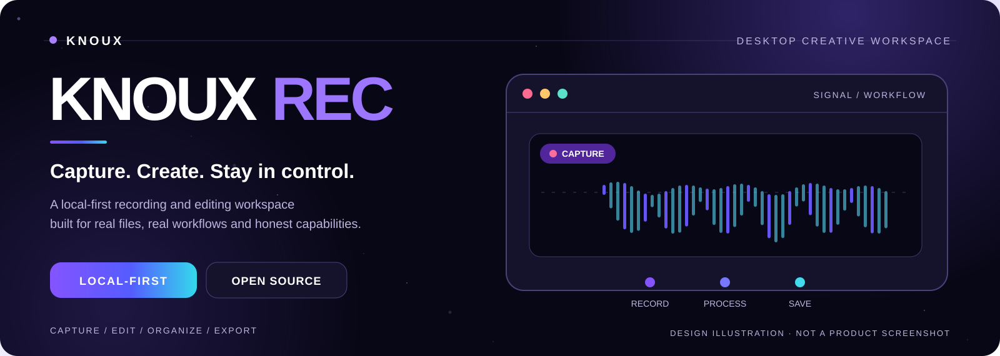
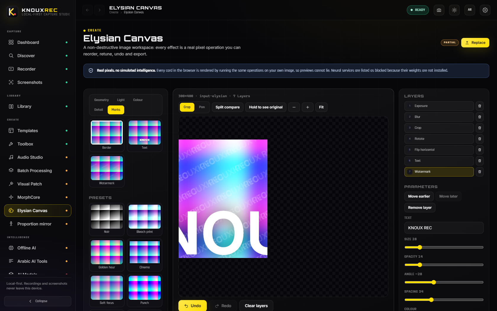
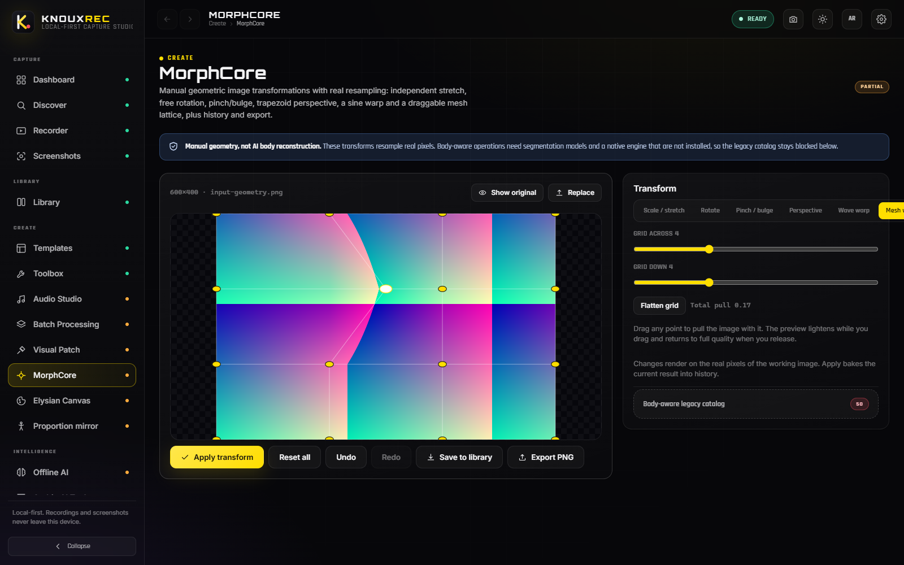
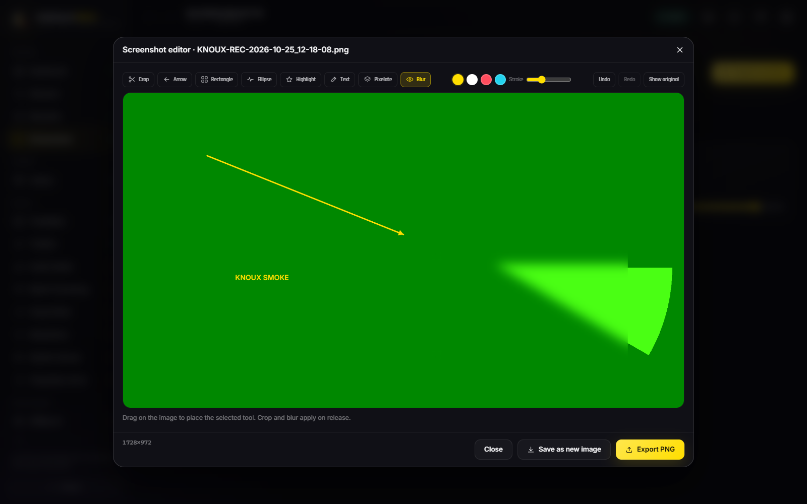
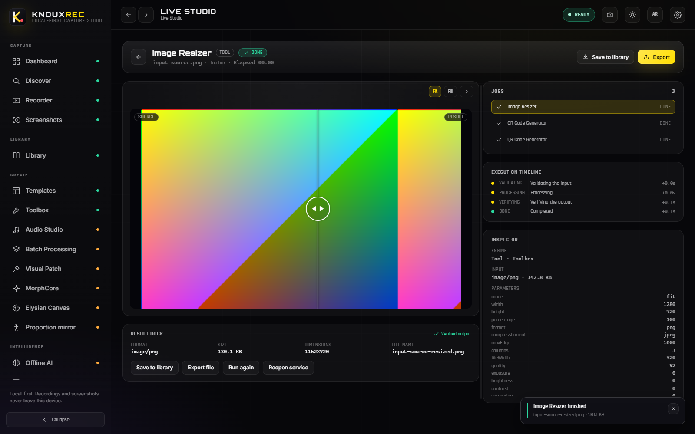
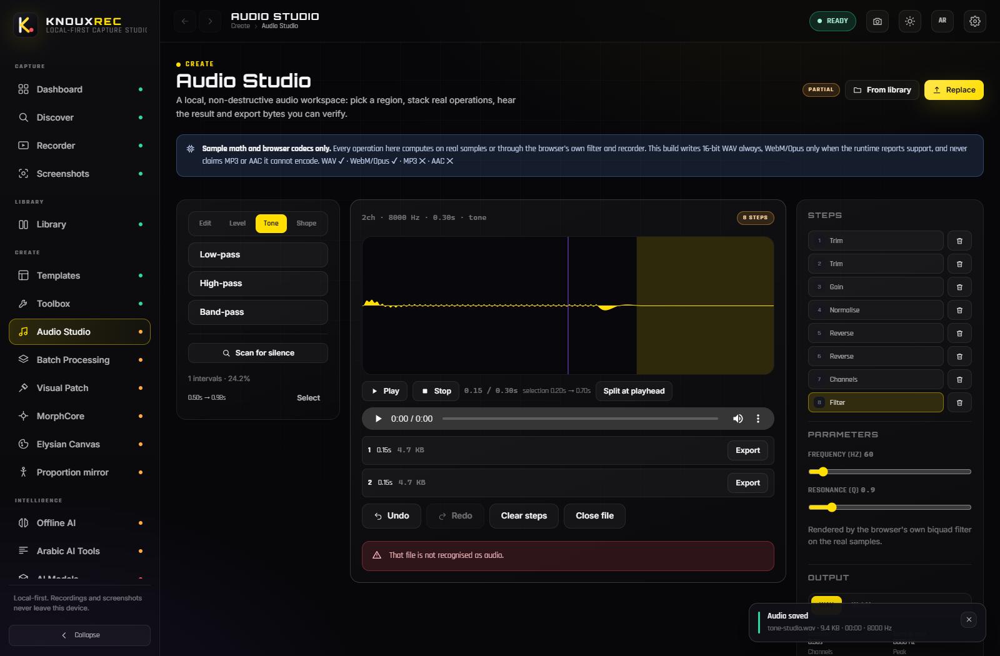
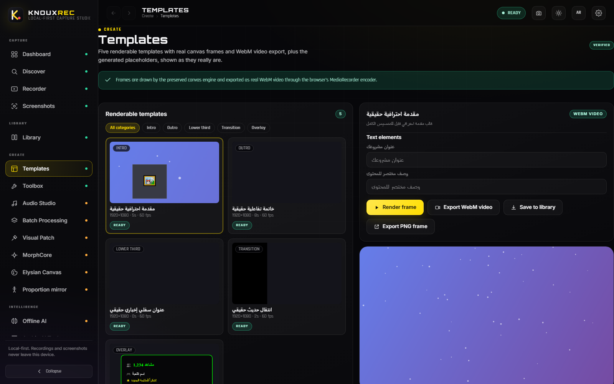
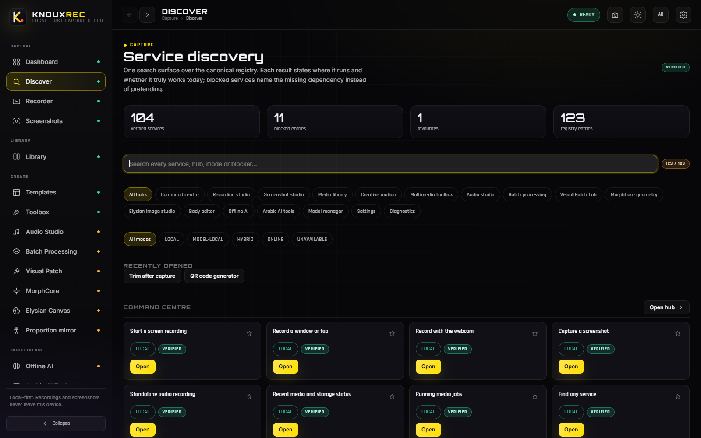
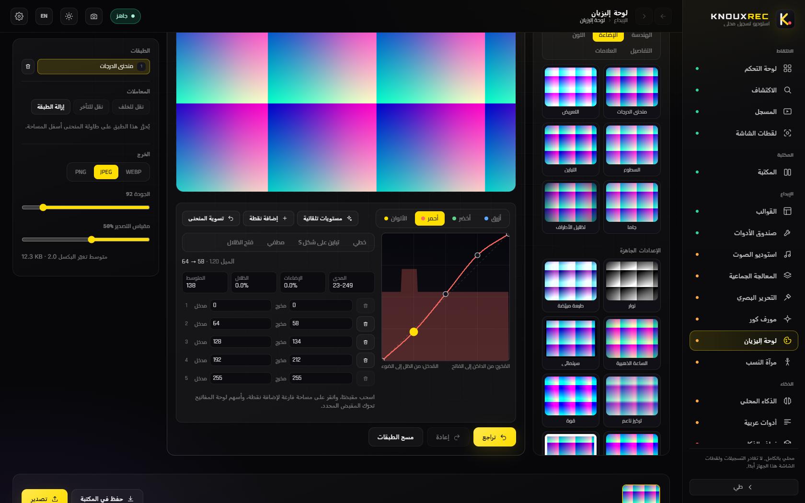
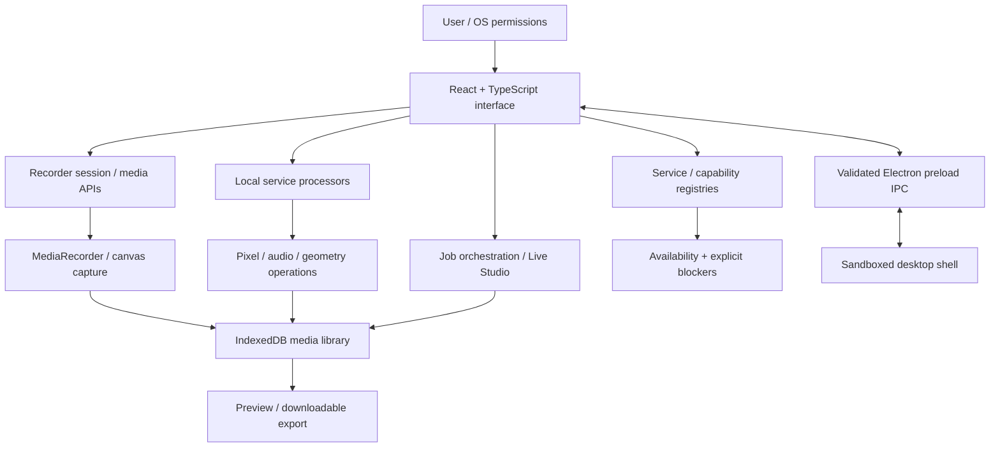

<div align="center">

<picture>
  <source media="(prefers-color-scheme: dark)" srcset="docs/readme/hero-dark.svg" />
  <source media="(prefers-color-scheme: light)" srcset="docs/readme/hero-light.svg" />
  
</picture>

<h1>KNOUX REC</h1>
<h3>Your creative command center. Built around real work, real files, and your device.</h3>
<p><strong>Record your screen · Shape your media · Organize your work · Export what you create</strong></p>
<p><a href="#-the-workspace"><strong>Explore capabilities</strong></a> &nbsp;·&nbsp; <a href="#-quick-start"><strong>Get started</strong></a> &nbsp;·&nbsp; <a href="#-architecture"><strong>Architecture</strong></a> &nbsp;·&nbsp; <a href="#-verification--quality-gates"><strong>Verify the claims</strong></a> &nbsp;·&nbsp; <a href="#-the-people-behind-knoux-rec"><strong>KNOUX</strong></a></p>
<p>
  
  
  
  
</p>
</div>

> [!IMPORTANT]
> **Beautiful interfaces deserve equally honest documentation.** KNOUX REC has working local processors, real recording and export paths, and a growing creative workspace. Some tools still require model weights or native engines that are **not shipped**. The latest service snapshot records **104 VERIFIED / 5 PARTIAL / 3 NOT-IMPLEMENTED / 11 BLOCKED** out of 123 registered services; these are *repository classifications from 25 October 2026*, **not newly executed test results**. See [service status](docs/STATUS_2026-10-25_SERVICES.md), the [service catalog](docs/COMPLETE_SERVICE_CATALOG.md), and the [capability registry](docs/CAPABILITY_REGISTRY.md).

---

## ✦ The idea

**A studio, not a collection of decorative buttons.**

KNOUX REC is a local-first desktop creative application built with **Electron, React, TypeScript and Vite**. It starts with screen/window/camera recording and expands into practical media workflows: screenshots, a persistent library, image editing, region-based image tools, geometry controls, audio utilities, local job execution and discoverable services.

The guiding principle is simple: **every enabled action should do something tangible**. A saved recording must have real encoded bytes. A screenshot must contain real captured pixels. An image export must reflect the visible edit. A model that is absent must remain clearly unavailable, rather than inventing a result.

<table>
<tr>
<td width="33%" valign="top">

### ◉ CAPTURE

Capture a display, window, camera or microphone session through real browser media APIs. Pause, resume, stop, or take a screenshot.

</td>
<td width="33%" valign="top">

### ◇ CREATE

Use actual processors for canvas edits, audio operations, video templates, masking, tone curves, and geometry workflows.

</td>
<td width="34%" valign="top">

### ▣ KEEP CONTROL

Save media to local IndexedDB, preview and organize it, then export files. No account or cloud upload is required.

</td>
</tr>
</table>

### In one view

| Principle | In the product | What it **does not** imply |
| :-- | :-- | :-- |
| **Local by design** | Media Blobs persist in IndexedDB on the current device | Data is **not encrypted at rest** |
| **Honest capabilities** | Supported actions execute real processors; blocked tools show a reason | Every catalog entry is **not** a shipped AI model |
| **Creative continuity** | Recording, editing, library, jobs and exports share local handoffs | No cloud collaboration or account sync |
| **Bilingual workspace** | English and Arabic with RTL layout and persistent preferences | A guarantee that every operating-system picker is translated |
| **Desktop focus** | Hardened Electron shell and Windows packaging workflow | Evidence of an installed binary for the current commit |

---

## ⌁ Navigate this README

| Discover | Build and operate |
| :-- | :-- |
| [The workspace](#-the-workspace) | [Quick start](#-quick-start) |
| [Capability truth table](#-capability-truth-table) | [First recording](#-your-first-recording) |
| [Creative workflows](#-creative-workflows) | [Architecture](#-architecture) |
| [Media and file lifecycle](#-media-and-file-lifecycle) | [Technology](#-technology--project-layout) |
| [Accessibility and localization](#-accessibility--localization) | [Verification](#-verification--quality-gates) |
| [What is not shipped](#-what-is-not-shipped) | [Privacy and security](#-privacy--security) |
| [Troubleshooting](#-troubleshooting) | [Contribution and project status](#-contributing--project-status) |
| [Founder and company](#-the-people-behind-knoux-rec) | [License](#-license) |

---

## ◈ Inside the actual application

The gallery below contains **screenshots captured from real KNOUX REC runtime smoke sessions**, not generated concept art. They are **historical test evidence**: consult the current code and re-run the smoke suites to validate a new build. Click any image to inspect it at full size.

<table>
<tr>
<td width="50%" valign="top"><a href="docs/readme/screenshots/elysian-layers.png"></a><br /><strong>Elysian Canvas</strong><br /><sub>Real image workspace · layers and editing controls</sub></td>
<td width="50%" valign="top"><a href="docs/readme/screenshots/morphcore-mesh.png"></a><br /><strong>MorphCore</strong><br /><sub>Local mesh deformation · visible control lattice</sub></td>
</tr>
<tr>
<td valign="top"><a href="docs/readme/screenshots/screenshot-editor.png"></a><br /><strong>Screenshot Editor</strong><br /><sub>Annotation and local pixel edits</sub></td>
<td valign="top"><a href="docs/readme/screenshots/live-studio.png"></a><br /><strong>Live Studio</strong><br /><sub>Image comparison · local jobs and readouts</sub></td>
</tr>
<tr>
<td valign="top"><a href="docs/readme/screenshots/audio-studio.png"></a><br /><strong>Audio Studio</strong><br /><sub>Waveform-focused workflows and operations</sub></td>
<td valign="top"><a href="docs/readme/screenshots/templates.png"></a><br /><strong>Templates</strong><br /><sub>Actual canvas template rendering</sub></td>
</tr>
<tr>
<td valign="top"><a href="docs/readme/screenshots/discover.png"></a><br /><strong>Service Discovery</strong><br /><sub>Registry-backed capabilities and blockers</sub></td>
<td valign="top"><a href="docs/readme/screenshots/arabic-rtl.png"></a><br /><strong>Arabic / RTL</strong><br /><sub>Authentic localized application interface</sub></td>
</tr>
</table>

---

## ◈ The workspace

KNOUX REC is a connected set of workspaces. The table below is organized around **working user journeys**, not a promise that every entry in each underlying catalog is available.

| Workspace | What you can do | Reality / limits |
| :-- | :-- | :-- |
| **Dashboard** | Start core actions, view recent local media, inspect jobs and diagnostics | Backed by local state |
| **Recording Studio** | Record display/window/camera; pause, resume, stop; microphone-only capture; delayed start | System audio depends on the OS / picker |
| **Screenshot Studio** | Capture pixels; crop; annotate with shapes, text and highlights; blur/pixelate; undo/redo; save/export | OS-native arbitrary region picking is not implemented |
| **Media Library** | Preview, rename, favorite, filter, export, delete and trim real recordings | Re-encoding trim may fail under sustained load |
| **Elysian Canvas** | Layer-based local image editing, presets, histograms/tone curves, comparison, PNG export | Generative/retouch/upscale AI paths need missing model artifacts |
| **Visual Patch** | Draw and manipulate regions, apply available local region processors, compare, export | Tool coverage is partial; do not infer every advertised family works |
| **MorphCore** | Local geometry workspace with draggable mesh warp and direct deformation controls | Body-aware native transformations are blocked |
| **Audio Studio** | Local analysis and editing operations with audio-oriented feedback | Some codec exports and model-backed cleanup are limited |
| **Templates** | Render five genuine canvas-backed templates to WebM | The 51 generated catalog entries are placeholders, **not** finished templates |
| **Toolbox** | Run local media utilities such as resizing, format conversion, thumbnails, waveforms, text/QR artwork and palette extraction | Behavior is processor-specific |
| **Live Studio** | Follow running jobs, see previews and resulting artifacts, save or export | Only actual supported jobs can execute |
| **Discover** | Search the canonical service registry, destinations, requirements and blockers | Listing a service is not proof of implementation |
| **Offline / Arabic AI** | Run deterministic local media utilities where implemented; inspect model requirements | Missing weights block model-dependent inference |
| **Models** | Inspect shipped manifests and readiness checks | A manifest is **not** an installed model |
| **Body Proportions** | Use a manual proportion mirror with measuring guides and spans | Not automated segmentation or body-shape AI |
| **Settings / Diagnostics** | Customize appearance, RTL/language and shortcuts; inspect measured runtime support | Device APIs and permissions still vary |

**Technical inventory:** [2026-10-25 service catalog](docs/COMPLETE_SERVICE_CATALOG.md) · [route and catalog registry](docs/CAPABILITY_REGISTRY.md) · [status with known defects](docs/STATUS_2026-10-25_SERVICES.md).

### Focus areas

<details>
<summary><strong>01 · Capture without pretending</strong></summary>

- Display/window recording uses `getDisplayMedia` and the user's source picker.
- Camera and microphone use `getUserMedia`; microphone-only sessions do not request a display source.
- Media is encoded with `MediaRecorder`, with supported formats probed at runtime.
- Pause/resume is handled by the recording session, not a cosmetic animation.
- A delayed start offers 3 / 5 / 10 / 30-second countdown options and cancellation. It is **page-scoped**, so a reload does not silently trigger a later recording.
- System-audio capture remains platform-dependent.
- Real image snapshots can be encoded as PNG, JPEG or WebP.

</details>

<details>
<summary><strong>02 · A library with real persistence</strong></summary>

- Clips, screenshots, audio and saved edits are represented by real binary Blobs.
- The local library supports preview, sorting/filtering, favorites, renaming, exporting and deletion.
- Where supported, trim makes a **new** recording while preserving the original.
- The trim path re-encodes through a real-time capture bridge; on heavily loaded machines it can yield no chunks and must return an error instead of inventing a file.
- Export creates real downloadable media bytes.

</details>

<details>
<summary><strong>03 · Image and geometry craftsmanship</strong></summary>

- Elysian includes local pixel operations, adjustable layers, tone curves and a measurable histogram.
- Visual Patch exposes visible region selection, masking and supported real canvas processors.
- MorphCore's mesh warp uses a draggable lattice and a calculated pixel displacement field.
- Body Proportions provides guides and measurements; segmentation and other model-dependent body tools remain unavailable.
- Rendering and export must preserve the edits shown in the workspace; a preview alone is not acceptance evidence.

</details>

<details>
<summary><strong>04 · Audio, templates and creative handoffs</strong></summary>

- Local audio sessions can be measured with a live dBFS meter.
- Supported audio tools operate on actual samples or waveform data.
- Five real templates render canvas frames and export encoded WebM.
- Shared jobs connect supported tools, recording and template exports into a visible lifecycle.
- Discover and workflow chains reuse existing processors; an entry in Discover is not a new standalone engine.

</details>

---

## ⬡ Capability truth table

**State labels are evidence-based and time-sensitive.** This is a summary of the [25 October 2026 services batch](docs/STATUS_2026-10-25_SERVICES.md), not a live dashboard and not a newly validated release.

| Registry state | Count | Interpretation |
| :-- | --: | :-- |
| **VERIFIED** | **104** | Evidence named in the repository for the implemented service |
| **PARTIAL** | **5** | A real path works, but a stated requirement, format or platform remains limited |
| **NOT-IMPLEMENTED** | **3** | Feature is not implemented and should not be represented as ready |
| **BLOCKED** | **11** | Missing weight, engine, codec/runtime dependency or other prerequisite |
| **TOTAL** | **123** | Registry entries, **not** 123 fully available tools |

### The nuance that matters

- **AI is not a magic checkbox.** The AI catalog contains 38 canonical tasks. The [capability registry](docs/CAPABILITY_REGISTRY.md) identifies deterministic tasks that run using local processors and model-dependent tasks that require missing weights.
- **A model inventory is not an inference engine.** Twenty-four manifests are documented, but model availability depends on real weight files and validation; an absent model must be surfaced honestly.
- **Partial means partial.** Examples: system audio availability, some audio exports, the scope of region-tool support, and model-backed Arabic/AI workflows.
- **Different sources were captured at different moments.** Generated route registries and service inventories may describe different build snapshots. Prefer the newest relevant code and its associated test evidence for a claim; re-run checks before declaring a release verified.

## ✕ What is not shipped

### Explicitly unavailable or incomplete

| Capability | Current constraint |
| :-- | :-- |
| Speech-to-text / OCR / AI retouch / generative image tooling | Required model weights are not shipped |
| Native body-aware segmentation and transformation | Required engine / segmentation artifacts are not shipped |
| Universal MP3 export and AI noise reduction | Required compatible implementation or artifacts are not shipped |
| Native OS-level arbitrary screenshot region enumeration | Not implemented; editor crop is the existing alternative |
| Persistent cross-session handoff | Handoff is deliberately memory-scoped |
| Model download pipeline | No silent or verified automatic model acquisition |
| Trim under sustained load | Real operation exists, but chained stress execution has shown intermittent zero-chunk capture failures |

> [!CAUTION]
> Do not treat navigation visibility, a model manifest, a catalog item, an older test report or a successful compile as proof of a working production feature.

---

## ✧ Creative workflows

### A real recording

```text
User gesture
    |
    v
OS / Chromium source picker
    |
    v
Display, camera or microphone stream
    |
    v
MediaRecorder + session state
    |
    v
Encoded media Blob
    |
    +----> Local IndexedDB library ----> Preview / Rename / Favorite
                                                |
                                                +----> Export a file
                                                +----> Trim into a new item*
```

*Trim is real but has the load-dependent failure described above.

### Media creation without a cloud round trip

```text
Import or capture pixels
    |
    +--> Screenshot Editor ----> Annotation / Crop / Privacy blur ----+
    |                                                                |
    +--> Elysian Canvas -----> Layers / Presets / Curves -------------+
    |                                                                |
    +--> Visual Patch --------> Mask / Region processor --------------+
    |                                                                |
    +--> MorphCore -----------> Local mesh displacement -------------+
                                                                     |
                                                       Render / Encode / Export
                                                                     |
                                                          Optional local save
```

### Practical examples

| Your goal | Recommended path | Expected proof |
| :-- | :-- | :-- |
| Capture a tutorial | Studio → Record → Library → Export | Playable media and a nonempty downloaded file |
| Annotate something sensitive | Screenshots → Blur/pixelate + annotations → Save | Pixel changes present in decoded export |
| Correct an image tone | Elysian → Curves / Preset → Compare → Export | Exported pixels reflect the selected curve |
| Create a short title card | Templates → Choose one of five real templates → Export | Valid playable WebM, measured duration |
| Record a voice memo | Dashboard or Studio → Microphone → Stop | Local audio Blob with playable duration |
| Resize multiple assets | Toolbox / Batch processor → Export | Correct image dimensions, per-file error isolation |
| Find a specific service | Discover → Search → Inspect status → Open | Correct destination, or an explicit blocker |

---

## ◇ Media and file lifecycle

KNOUX REC is **local-first**, but local does not automatically mean backed up, encrypted, indestructible or portable.

1. **Acquire:** capture media streams or select a local file with an explicit user action.
2. **Transform:** run supported image, audio or video operations on local data.
3. **Persist:** write real media Blobs and metadata into the on-device IndexedDB library.
4. **Inspect:** reconstruct playable previews and job state from persisted records.
5. **Export:** write a user-accessible file with an appropriate encoded format.
6. **Protect your work:** export important originals and edits; browser profile reset, data clearing and OS failures can erase local IndexedDB records.

| Data | Location | Notes |
| :-- | :-- | :-- |
| Recorded media and saved edits | IndexedDB (`knoux-rec.library`) | Actual binary data, local to the browser/Electron profile |
| Preferences | localStorage (`knoux-rec.settings.v1`) and related settings storage | Theme, language and recording preferences |
| Downloaded exports | User-selected/download location | Normal files outside the application database |
| Built-in model manifests | Bundled project assets | Presence does **not** guarantee usable model weights |
| Shared jobs/handoffs | Local application runtime and associated state | Not a cloud synchronization system |

---

## ◉ Quick start

### Requirements

| Requirement | Details |
| :-- | :-- |
| Runtime | **Node.js 18+**, **npm 8+**; project CI uses Node 22 |
| Platforms | Electron desktop workflow, primarily validated with Windows packaging |
| Browser | Modern Chromium-based runtime for the renderer and capture smoke tests |
| Permissions | OS / browser approval for screen, window, camera and microphone capture |
| Disk | Space for dependencies, builds and local media exports |

### Clone and install

```bash
git clone https://github.com/daynightae-cmyk/Knouxrec.git
cd Knouxrec
npm ci
```

### Develop

```bash
npm run dev           # Vite renderer dev server
npm run electron      # Electron desktop shell
```

**Important:** The Vite renderer and the Electron shell do not have identical platform privileges. Run tests appropriate to the behavior you are changing.

### Build

```bash
npm run build         # Production renderer -> dist/
npm run electron:dist # Renderer + Electron packaging -> release/
```

On Windows, the packaging configuration targets **NSIS**. The package is not evidence of a successful installed runtime until the produced binary boots and passes its smoke checks.

The Electron entry point is [`knoux-rec-app/main.cjs`](knoux-rec-app/main.cjs). CommonJS is intentional: the package declares `"type": "module"`, while Electron's packaged main-process entry needs the `.cjs` loader behavior.

---

## ● Your first recording

1. Open **Recording Studio** or use **Ctrl + Shift + R** with default shortcut settings.
2. Choose a screen/window in the system picker; optionally enable webcam or microphone capture.
3. Use **Ctrl + Shift + P** to pause/resume where supported.
4. Stop with **Ctrl + Shift + R**, then open **Library**.
5. Preview the real encoded media; rename, favorite or export it.

| Default shortcut | Action |
| :-- | :-- |
| `Ctrl + Shift + R` | Start / stop recording |
| `Ctrl + Shift + P` | Pause / resume |
| `Ctrl + Shift + S` | Screenshot |

Some shortcuts can be rebound in **Settings**. Conflicts are refused rather than silently replacing an existing action. Keyboard/OS interception may differ across platforms.

---

## ⟁ Architecture

KNOUX REC separates the desktop host, renderer interface, local processing engines and persistence. The diagram is an **architecture overview**, not a claim that every registry entry has a working processor.



### Boundary rules

| Boundary | Responsibility | Safety expectation |
| :-- | :-- | :-- |
| **Renderer** | UI, interaction, media pipelines | No Node integration or unrestricted native access |
| **Electron main + preload** | Window lifecycle, source selection and constrained desktop bridge | Context isolation, sandbox, validated IPC and navigation restrictions |
| **Local processors** | Perform actual media transformations | Deterministic output, errors surfaced rather than faked |
| **Library** | Store and reload Blobs and metadata | Never conflate an object URL with persisted media |
| **Capability registry** | Declare routes, execution modes, model availability and blockers | Accurate status, traceable evidence |
| **CI / smoke** | Prove important behavior using scripts and packaged runtime where available | Commit-specific results, not timeless guarantees |

### Selected implementation map

| Concern | Entry point / evidence |
| :-- | :-- |
| Desktop process | [`knoux-rec-app/main.cjs`](knoux-rec-app/main.cjs) |
| Desktop preload | [`knoux-rec-app/preload.cjs`](knoux-rec-app/preload.cjs) |
| App service inventory | [`src/data/serviceRegistry.ts`](src/data/serviceRegistry.ts) |
| Local image algorithms | [`src/services/imageOps.ts`](src/services/imageOps.ts) |
| Local geometry algorithms | [`src/services/geometryOps.ts`](src/services/geometryOps.ts) |
| Model availability | [`src/services/modelRegistry.ts`](src/services/modelRegistry.ts) |
| Test entry points | [`scripts/`](scripts/) |
| Build / scripts | [`package.json`](package.json) |
| CI | [`.github/workflows/ci.yml`](.github/workflows/ci.yml) |

---

## ⌘ Technology & project layout

<table>
<tr><th align="left">Product layer</th><th align="left">Technologies and responsibilities</th></tr>
<tr><td>Desktop shell</td><td>Electron 45 · sandboxed windows · source picker · restricted preload IPC</td></tr>
<tr><td>Interface</td><td>React 19 · TypeScript 5.7 · Vite 6 · component-based UI</td></tr>
<tr><td>Media runtime</td><td>MediaDevices · MediaRecorder · Canvas 2D · Web Audio · browser codec probing</td></tr>
<tr><td>Local data</td><td>IndexedDB · localStorage · Blob / object URLs</td></tr>
<tr><td>Quality</td><td>TypeScript checks · ESLint · Vitest · Puppeteer / Chrome DevTools Protocol · Electron smoke</td></tr>
<tr><td>Packaging</td><td>electron-builder · Windows NSIS installer</td></tr>
</table>

```text
Knouxrec/
├── .github/workflows/   # CI
├── knoux-rec-app/       # Electron main, preload, source picker
├── src/
│   ├── app/             # Navigation, capabilities and UI infrastructure
│   ├── data/            # Catalogs / service registry
│   ├── services/        # Media, geometry and workflow processors
│   ├── state/           # Shared job and application state
│   └── ui/              # Interactive workspaces and controls
├── services/            # Additional processors and template engine
├── scripts/             # Unit / smoke / verification runners
├── docs/                # Capability and status evidence
│   └── readme/          # Original, accessible README artwork
├── public/              # Bundled assets and model manifests
├── package.json
└── README.md
```

Project paths reflect the inspected repository at this documentation revision; individual modules may move as the product evolves.

---

## ◐ Accessibility & localization

The workspace includes English and Arabic localization with **RTL-aware layout**. The codebase also addresses high-density screens, reduced-motion preferences, navigation history, and keyboard interactions. Those properties need renewed regression checks when screens change.

- Language, theme and related preferences persist locally.
- `lang` and `dir` are applied at the document root for Arabic mode.
- Reduced-motion behavior is tested through browser media emulation.
- Interactive tools need keyboard-accessible controls, feedback states and distinguishable disabled states.
- A visually attractive screen that silently loses an older working tool is a **regression**, even when TypeScript and the build pass.

---

## ◎ Verification & quality gates

**Quality means measured behavior, not a green-looking badge.**

```bash
npm run type-check     # TypeScript diagnostics
npm run lint           # ESLint, zero warnings policy
npm run check:i18n     # Localized UI string coverage
npm test               # Vitest unit tests
npm run build          # Production renderer
npm run verify         # Combined static/unit/build gate
```

### Runtime smoke coverage

```bash
npm run smoke:ui
npm run smoke:recording
npm run smoke:screen
npm run smoke:error
npm run smoke:electron
npm run smoke:packaged
npm run smoke:elysian
npm run smoke:visual-patch
npm run smoke:morphcore
npm run smoke:elysian-studio
npm run smoke:audio-studio
npm run smoke:audio-recording
npm run smoke:discover
npm run smoke:workflows
npm run smoke:batch
npm run smoke:handoff
npm run smoke:all       # Entire configured chain; potentially lengthy
```

These are **representative** suites; inspect [`package.json`](package.json) for the complete current smoke chain. Some suites need a built app, running preview server, Chromium/Electron facilities or packaged binaries. Follow each script's prerequisites instead of assuming all tests work in every environment.

### Known 25 October 2026 validation snapshot

| Gate | Historical result | Interpretation |
| :-- | :-- | :-- |
| `npm run verify` | Passed on the services branch | Included type checks, lint, i18n over 24 views plus shared surface, **227 unit tests**, and build |
| Individual smoke suites | Each had a successful standalone run | Does **not** mean the chained run was green |
| `npm run smoke:all` | **Not consistently green** | Intermittent recording trim re-encode failure under sustained load |
| Windows packaged smoke | Passed against an **older package** | Binary was not rebuilt for that services batch |

This is historical [documented evidence](docs/STATUS_2026-10-25_SERVICES.md), **not a test execution performed by this README edit**. For how assertion counts are defined and why earlier reported totals were corrected, see [verification methodology](docs/VERIFICATION_METHOD.md).

> [!WARNING]
> Never report PASS / VERIFIED / COMPLETE solely because a test was green in a different commit, a standalone run passed, or a previously packaged build opened.

---

## ⛨ Privacy & security

| Property | Current posture |
| :-- | :-- |
| Cloud service | No account, telemetry pipeline or mandatory cloud synchronization |
| Media ownership | User captures and exports media locally |
| Network boundary | The app renderer enforces a restrictive Content Security Policy and is designed not to load remote resources |
| Electron isolation | `nodeIntegration: false`, `contextIsolation: true`, `sandbox: true`; navigation and IPC are constrained |
| Capture permissions | Screen, camera and mic permissions require an explicit user action and OS/browser approval |
| At-rest encryption | **Not implemented**; local capture data can be read by other processes with the same OS user privileges |
| Backups | Your exported originals are your responsibility; clearing app/browser storage may remove the library |
| AI and models | Missing weights are identified; they are not silently downloaded or executed through an unapproved cloud fallback |

**Threat-model reminder:** Local-only storage reduces cloud exposure but does **not** defend against a compromised operating-system account, malware running as the same user, or unencrypted profile backups.

Security, user gesture handling, storage lifetime and media permissions must be reassessed for any new Electron IPC surface or third-party network integration.

---

## ▤ Troubleshooting

<details>
<summary><strong>The screen picker does not open / capture is denied</strong></summary>

Confirm a direct user gesture triggered recording. Check OS screen-recording permissions, available capture surfaces, and whether the action runs inside the Electron shell or standalone browser. The error UI should explain denial; it must not display a fabricated preview.

</details>

<details>
<summary><strong>There is no system audio in my recording</strong></summary>

System-audio tracks depend on browser, OS, selected surface and permission. The project cannot guarantee the platform exposes such a track. For narration, enable a supported microphone source instead.

</details>

<details>
<summary><strong>A model tool says unavailable</strong></summary>

Inspect **Models**, **Discover** and the capability registry. A catalog manifest without weights is not executable. No public README claim overrides a missing model or native engine.

</details>

<details>
<summary><strong>My exported trim is empty or failed</strong></summary>

This is a known load-sensitive path. The implementation rejects zero-byte / no-chunk results instead of asserting success. Preserve the original media, retry without heavy system load, and consult the recording smoke evidence. Do not delete the source after a failed trim.

</details>

<details>
<summary><strong>A preview works, but the installed desktop application does not</strong></summary>

The renderer build, Electron integration and packaged Windows executable are separate validation levels. Rebuild the package and run the packaged smoke test on the exact candidate before release.

</details>

<details>
<summary><strong>My local library seems to have disappeared</strong></summary>

Check which browser/Electron profile is being used and whether site/application data was cleared. IndexedDB is per profile; KNOUX REC does not promise cloud restoration. Keep backups of important exported files.

</details>

---

## ⊕ Contributing & project status

The highest-value changes are those that close **real, measurable gaps**, preserve existing visual intent, and keep offline/privacy boundaries honest.

1. Review [`CONTRIBUTING.md`](CONTRIBUTING.md), [project status](docs/PROJECT_STATUS.md) and the [service inventory](docs/COMPLETE_SERVICE_CATALOG.md).
2. Inspect the latest `main` source, outstanding PRs and test reports before implementing a service.
3. Keep working processors and accepted UI assets intact; do not replace functional execution with placeholder data.
4. Add tests for pixel, audio, export, persistence, error and localization contracts where relevant.
5. Run the appropriate static, unit, runtime and packaged gates; state clearly which passed and which were not run.
6. Avoid destructive Git operations, unapproved third-party telemetry, and invisible model downloads.

**Current engineering priorities reflected in the evidence:** stabilize load-sensitive trim encoding, keep packaged validation aligned with current builds, fill missing engine/weight dependencies only with approved real implementations, and prevent UI regressions.

### Evidence before claims

- [Latest documented services batch](docs/STATUS_2026-10-25_SERVICES.md)
- [Detailed service matrix](docs/COMPLETE_SERVICE_CATALOG.md)
- [Generated capabilities](docs/CAPABILITY_REGISTRY.md)
- [Verification counting method](docs/VERIFICATION_METHOD.md)
- [No-external-APIs notes](docs/NO_EXTERNAL_APIS.md)
- [Third-party notices](docs/THIRD_PARTY_NOTICES.md)
- [GitHub Actions configuration](.github/workflows/ci.yml)

---

## ◆ The people behind KNOUX REC

<div align="center">
<a href="https://knoux.store/"></a>
<h3>KNOUX</h3>
<p><strong>Independent software craft. Purpose-built digital products.</strong></p>
<p><strong>Founder &amp; Software Engineer</strong><br /><strong>Eng. Sadek Elgazar · م. صادق الجزار</strong></p>
<p><em>KNOUX is the parent corporate brand. KNOUX REC retains its own product identity, engineering truth and roadmap.</em></p>
</div>

| Official channel | Contact |
| :-- | :-- |
| 🌐 **Company website** | [knoux.store](https://knoux.store/) |
| ✉️ **Corporate email** | [admin@knoux.store](mailto:admin@knoux.store) |
| ☎️ **Telephone** | [+971 50 328 1920](tel:+971503281920) |
| 💬 **WhatsApp** | [Message KNOUX](https://wa.me/971503281920) |
| 🏢 **Company Facebook** | [KNOUX Store](https://www.facebook.com/knouxStore/) |
| 👨‍💻 **Founder's Facebook** | [Eng. Sadek Elgazar](https://www.facebook.com/CopSadek) |
| ⌘ **Engineering GitHub** | [daynightae-cmyk](https://github.com/daynightae-cmyk) |
| ◈ **KNOUX GitHub** | [knoux-io](https://github.com/knoux-io) |
| ▶ **TikTok** | [@knoux_7](https://www.tiktok.com/@knoux_7) |

**Founder profile:** Software engineering, full-stack digital products, desktop/mobile development, AI integrations, intelligent automation and user experience. These are professional domains of the developer; they are **not** a claim that every technology is shipped in KNOUX REC.

---

## ◇ License

Released under the **MIT License**. Read the full [LICENSE](LICENSE) and the repository's [third-party notices](docs/THIRD_PARTY_NOTICES.md) for additional context.

<div align="center">
<hr />
<h3>KNOUX REC — make something real.</h3>
<p><strong>Capture with confidence. Create with purpose. Keep control.</strong></p>
<p><a href="#knoux-rec">Back to top</a> · <a href="src/">Explore the code</a> · <a href="docs/COMPLETE_SERVICE_CATALOG.md">View the service inventory</a> · <a href="mailto:admin@knoux.store">Contact KNOUX</a></p>
<p><sub>Crafted by KNOUX · Eng. Sadek Elgazar · Documentation statements are evidence-scoped, not automatic release certifications.</sub></p>
</div>
